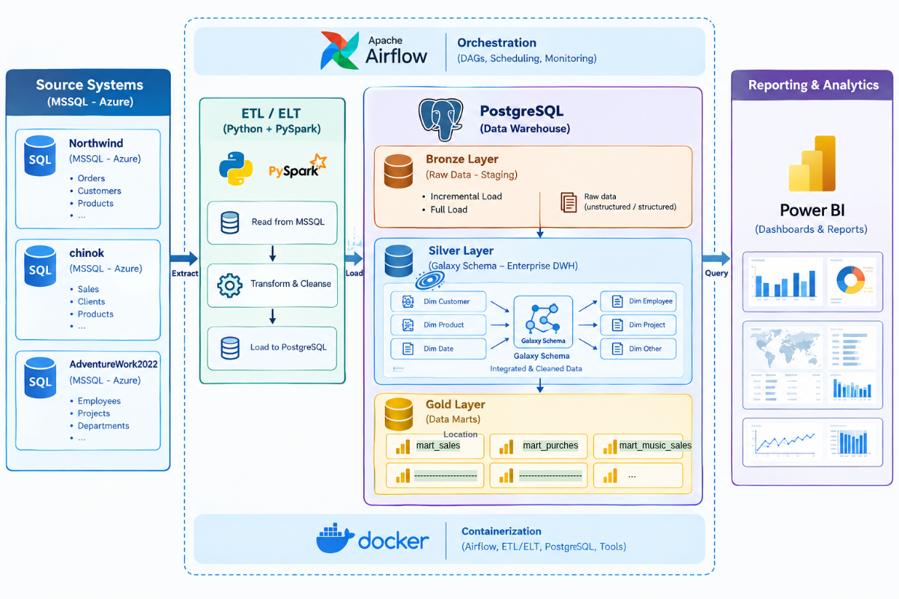
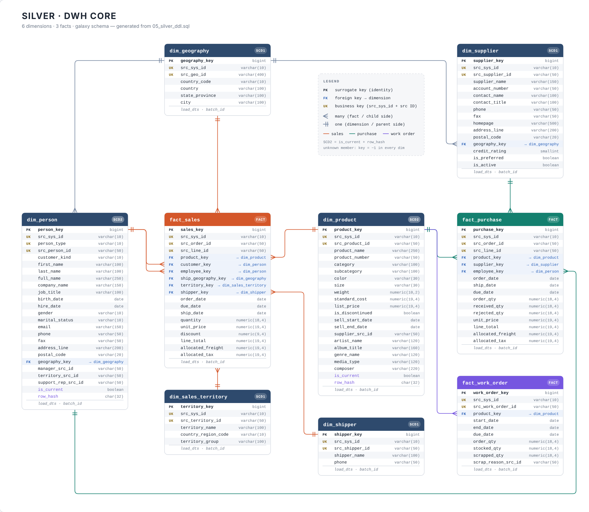
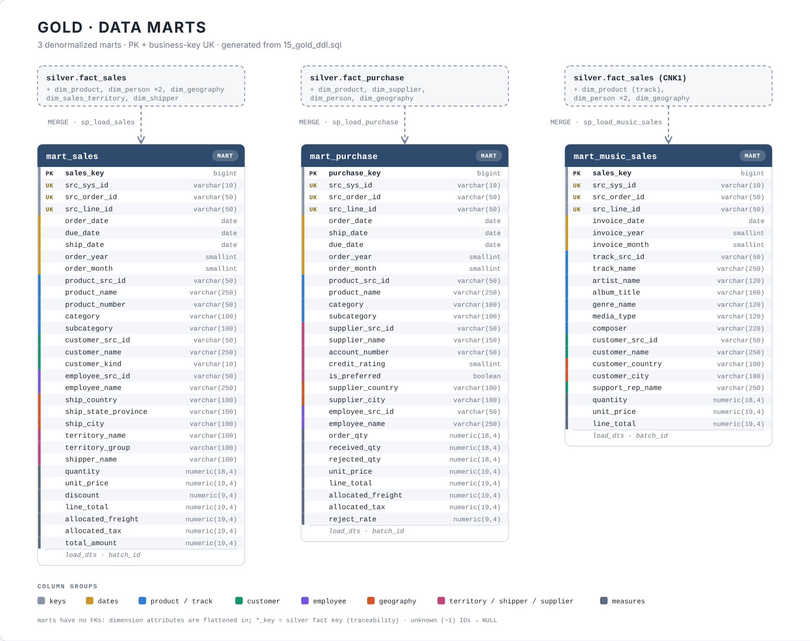

# PySpark ETL Data Lakehouse on PostgreSQL





PySpark ETL Data Lakehouse on PostgreSQL

Pipeline

🚀 End-to-End PySpark ETL pipeline that builds an analytical Data Lakehouse on PostgreSQL from three MSSQL source databases, following modern Data Engineering and Dimensional Modeling (Galaxy Schema) principles. The whole pipeline is orchestrated by Apache Airflow running in Docker.

This project demonstrates how to:

Extract data from MSSQL with PySpark (JDBC)
Land it in a Bronze layer (raw copy, partitioned by load date)
Build a Silver layer: an enterprise DWH with a Galaxy Schema (conformed dimensions shared by several fact tables), loaded by PostgreSQL stored procedures (MERGE)
Publish denormalized Gold data marts for reporting and BI tools
Orchestrate everything with an Airflow DAG in Docker


## 🧠 Architecture Overview

The project follows a layered ETL&ELT approach inspired by modern data architectures:

Source Data (MSSQL)
  ↓
  ↓
PySpark ETL&ELT 
          ↓
          ↓
    PostgreSQL   
          ↓
    Bronze Layer - (Copy/Past tables_
          ↓
    Silver Layer - Data Lakehouse (Galaxy Schema) 
          ↓
    Gold Layer - (Data marts )


/*********************************************************************************************************/
/*********************************************************************************************************/
/*********************************************************************************************************/
## 🥉 Bronze Layer – Source Tables

Bronze is a raw 1:1 copy of **36 source tables** from three MSSQL databases. Every table has the primary key `(source key, load_date)` and is partitioned by `load_date` (yearly partitions + a default partition). Table names follow the pattern `bronze.<source>_<table>`.

### Northwind (`NW1`) – 8 tables

| Source table | Bronze table |
|---|---|
| `Customers` | `bronze.nw1_customers` |
| `Employees` | `bronze.nw1_employees` |
| `Products` | `bronze.nw1_products` |
| `Categories` | `bronze.nw1_categories` |
| `Suppliers` | `bronze.nw1_suppliers` |
| `Shippers` | `bronze.nw1_shippers` |
| `Orders` | `bronze.nw1_orders` |
| `Order Details` | `bronze.nw1_order_details` |

### Chinook (`CNK1`) – 9 tables

| Source table | Bronze table |
|---|---|
| `Customer` | `bronze.cnk1_customer` |
| `Employee` | `bronze.cnk1_employee` |
| `Artist` | `bronze.cnk1_artist` |
| `Album` | `bronze.cnk1_album` |
| `Track` | `bronze.cnk1_track` |
| `Genre` | `bronze.cnk1_genre` |
| `MediaType` | `bronze.cnk1_mediatype` |
| `Invoice` | `bronze.cnk1_invoice` |
| `InvoiceLine` | `bronze.cnk1_invoiceline` |

### AdventureWorks2022 (`AW22`) – 19 tables

| Source table | Bronze table |
|---|---|
| `Sales.SalesOrderHeader` | `bronze.aw22_salesorderheader` |
| `Sales.SalesOrderDetail` | `bronze.aw22_salesorderdetail` |
| `Sales.Customer` | `bronze.aw22_customer` |
| `Sales.SalesPerson` | `bronze.aw22_salesperson` |
| `Sales.SalesTerritory` | `bronze.aw22_salesterritory` |
| `Sales.Store` | `bronze.aw22_store` |
| `Person.Person` | `bronze.aw22_person` |
| `Person.Address` | `bronze.aw22_address` |
| `Person.StateProvince` | `bronze.aw22_stateprovince` |
| `Person.CountryRegion` | `bronze.aw22_countryregion` |
| `Person.BusinessEntityAddress` | `bronze.aw22_businessentityaddress` |
| `HumanResources.Employee` | `bronze.aw22_employee` |
| `Production.Product` | `bronze.aw22_product` |
| `Production.ProductSubcategory` | `bronze.aw22_productsubcategory` |
| `Production.ProductCategory` | `bronze.aw22_productcategory` |
| `Production.WorkOrder` | `bronze.aw22_workorder` |
| `Purchasing.PurchaseOrderHeader` | `bronze.aw22_purchaseorderheader` |
| `Purchasing.PurchaseOrderDetail` | `bronze.aw22_purchaseorderdetail` |
| `Purchasing.Vendor` | `bronze.aw22_vendor` |


## 📊 Data Modeling: Silver Layer - Data Lakehouse (Galaxy Schema) 

Dimensions: dim_geography, dim_person (customers + employees), dim_product, dim_supplier, dim_shipper, dim_sales_territory
Facts: fact_sales, fact_purchase, fact_work_order
Surrogate keys on every table (GENERATED ... AS IDENTITY), PK / FK constraints everywhere
SCD Type 2 (is_current + row_hash) for dim_person and dim_product; all other dimensions are SCD1
Unknown member: key -1 in every dimension, so facts never lose rows when a lookup fails
Header-level freight and tax are allocated to order lines proportionally to line_total
Dates are stored directly in the facts (no dim_date)



## 📊 Data Modeling: Silver Layer - Gold Layer 

Mart	Grain	Sources
gold.mart_sales	one sales line	AW22 + NW1 + CNK1
gold.mart_purchase	one purchase order line	AW22
gold.mart_music_sales	one invoice line (music analytics)	CNK1

Marts are denormalized (dimension attributes are flattened in), carry derived columns (order_year, order_month, total_amount, reject_rate) and are indexed for BI queries.




## ⚙️ Orchestration

Airflow DAG **`dwh_pipeline`**:

```
bronze_aw22 → bronze_cnk1 → bronze_nw1 → silver → gold
```

- Bronze tasks run one after another (one Spark session at a time)
- `silver` calls `CALL silver.sp_load_*` procedures; `gold` calls `CALL gold.sp_load_mart_*`
- One `batch_id` is passed through Silver and Gold, so every row can be traced to the run that loaded it
- `max_active_runs=1`, `catchup=False`; the schedule is configurable in `dags/dwh_pipeline.py`

---

## 📁 Project Structure

```
.
├── Bronze_Layer/          # PySpark loaders per source (AW22, NW1, CNK1)
├── Silver_Layer/          # Python wrapper that runs the Silver procedures
├── Gold_Layer/            # Python wrapper that runs the Gold procedures
├── utils/                 # config, logger, Spark session, Postgres helper
├── dags/                  # Airflow DAG (dwh_pipeline)
├── jars/                  # JDBC drivers (MSSQL, PostgreSQL)
├── Dockerfile             # Airflow + Java 17 + PySpark
├── docker-compose.yaml    # Airflow (webserver, scheduler, init) + metadata DB
└── requirements.txt
```

---

## ▶️ How to Run

1. **Create the database objects** in PostgreSQL (schemas `bronze`, `silver`, `gold`: tables first, then the stored procedures).
2. **Put the JDBC drivers** (MSSQL and PostgreSQL) into `jars/`.
3. **Create a `.env`** next to `docker-compose.yaml` (never commit it):

```env
AIRFLOW_UID=1000

DB_SQL_DATABASE_AdventureWorks2022=AdventureWorks2022
DB_SQL_DATABASE_NORTHWND=Northwind
DB_SQL_DATABASE_Chinook=Chinook
DB_SQL_USER=your_user
DB_SQL_PASSWORD=your_password
DB_SQL_DRIVER=com.microsoft.sqlserver.jdbc.SQLServerDriver

DB_POSTGRESQL_DATABASE=DWH
DB_POSTGRESQL_USER=your_user
DB_POSTGRESQL_PASSWORD=your_password
DB_POSTGRESQL_DRIVER=org.postgresql.Driver
DB_POSTGRESQL_PORT=5432
```

   Inside Docker the databases on the host are reached through `host.docker.internal` (set in `docker-compose.yaml` via `DB_SQL_HOST` and `DB_POSTGRESQL_HOST`).

4. **Start Airflow:**

```bash
docker compose up -d --build
```

5. Open **http://localhost:8081** (`admin` / `admin`), find `dwh_pipeline` and press **Trigger DAG**.

> If PostgreSQL runs on the host machine, it must accept connections from the Docker network (`listen_addresses` and `pg_hba.conf`).

---

## 🗺️ Roadmap

- Power BI (or another BI tool) dashboards on top of the Gold marts
- Data quality checks between layers
- Reference tables (`dim_source_system`) instead of `CHECK` constraints on `src_sys_id`
- Partitioning of large Silver facts
